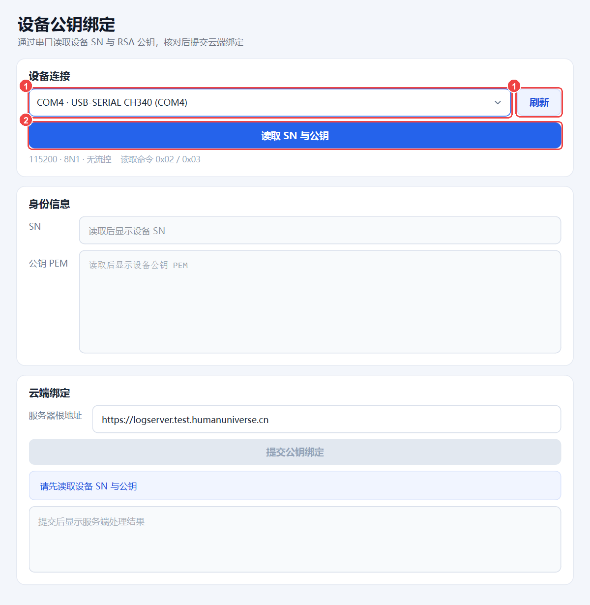
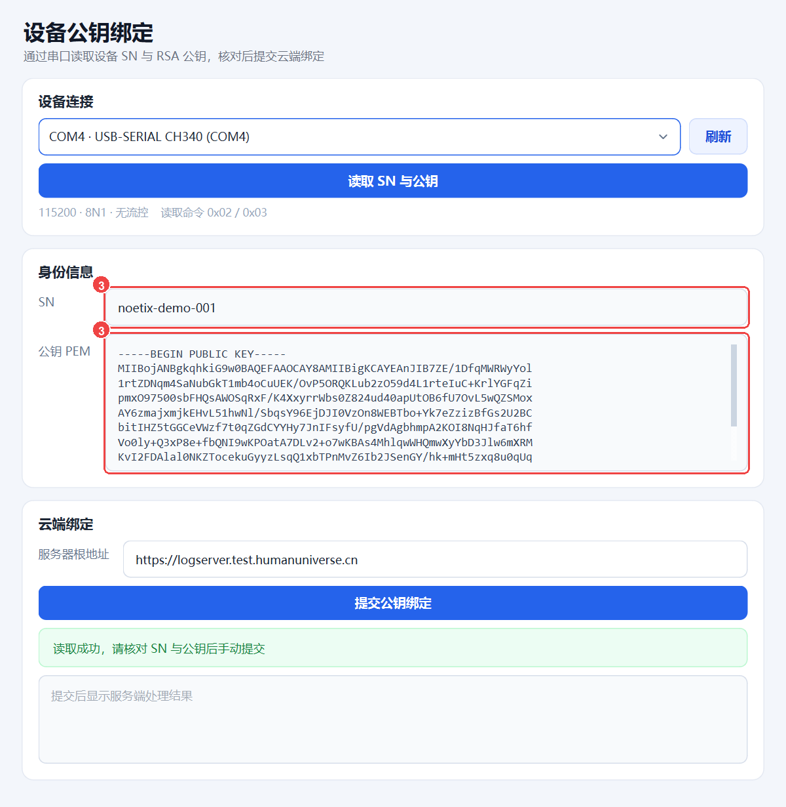
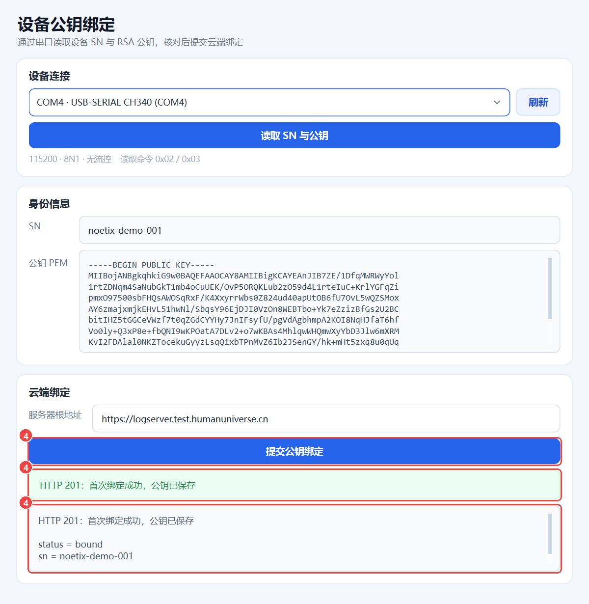

# 设备公钥绑定工具 · 使用说明

通过串口读取设备 SN 与 RSA-3072 公钥，核对后提交云端绑定。

## 使用前准备

- 用 USB 串口线连接设备，确认电脑已识别串口（CH340 等驱动正常）。
- 启动工具：

  ```powershell
  .\.venv\Scripts\python.exe main.py
  ```

- 确认“服务器根地址”正确，默认已填好测试环境地址。

> 工具只从串口读取数据，不访问 Ubuntu 中的 `device_rsa` 或 `sn.txt` 文件。

## 操作步骤

### 1. 选择串口

在“设备连接”中点击“刷新”，在下拉框选择设备的 COM 口。列表为空时，检查 USB 线、驱动，或点刷新重试。



### 2. 读取 SN 与公钥

点击“读取 SN 与公钥”。工具会通过串口依次读取 SN（`0x02`）和公钥（`0x03`）。读取成功后，SN 与 PEM 公钥自动填入“身份信息”，状态栏变绿。

> 读取期间按钮会暂时锁定；读完自动恢复，不会自动提交。



### 3. 核对并提交

核对 SN 与设备标签一致，确认服务器地址无误后，点击“提交公钥绑定”。提交完成后查看状态栏和“结果详情”：绿色表示成功，红色表示失败。



## 状态颜色

| 颜色 | 含义 |
|---|---|
| 蓝色 | 读取中或等待核对，例如“正在通过 COM4 读取…” |
| 绿色 | 读取成功或绑定成功，例如“HTTP 201：首次绑定成功” |
| 红色 | 读取或绑定失败，具体原因见状态栏与结果详情 |

## 常见问题

- **没有串口**：更换 USB 口或数据线，安装 CH340 驱动后点“刷新”。
- **读取失败 / 打开串口失败**：关闭占用该串口的其他软件，重新插拔后再读。
- **HTTP 403**：当前出口 IP 不在工厂白名单，请联系后台开通。
- **HTTP 404**：该 SN 在机器人台账中不存在，核对 SN 或联系后台。
- **HTTP 409**：该 SN 已绑定过不同公钥，需要人工排查，不要反复提交。

> 工具不会自动重试、自动提交，也不跟随重定向；失败后请查明原因再手动点击。

## 安全说明

- 设备返回私钥时，工具只在内存中推导公钥，私钥不会显示、保存或上传。
- 上传前统一转换为 `SubjectPublicKeyInfo` PEM，并校验为 RSA-2048/3072。
- 提交使用系统信任库校验证书链、有效期和主机名。
- 结果详情中的 Token 等敏感信息会自动脱敏。
